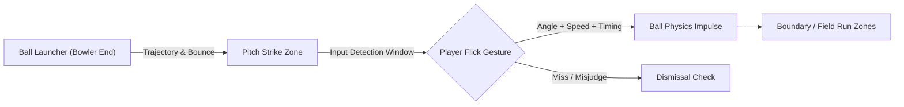

# FlickSix — Architecture & Gameplay Strategy Report

**Codename:** FlickSix  
**Status:** Pre-Production / Blueprint Phase  
**Target Platform:** Mobile / PC (Touch & Mouse Flick)  

---

## 1. Executive Summary & Decisions Made

* **Game Engine:** **Godot Engine 4 (3D)** — Selected for lightweight performance, low hardware requirements, fast iteration loop, and excellent handling of stylized low-poly 3D.
* **Prototyping Mandate:** No third-party or custom assets in initial development. Pure Godot primitives (boxes, cylinders, spheres, CSG meshes) to establish mechanics and game feel first.
* **Camera Perspective:** Fixed behind-the-batter striker view facing down the pitch towards the bowler.
* **Core Loop:** Target chase mode — player faces an over/overs chasing a target score using intuitive flick-to-hit controls.

---

## 2. Core Mechanics Architecture (Phase 1 Focus)

### 2.1. Ball Delivery System
* **Spawn Point:** Bowler delivery stride position (~20–22 yards out).
* **Delivery Parameters:** Speeds, bounce coordinates, and variations to be dynamically calibrated during live testing.

### 2.2. Batting & Flick Mechanics
* **Shot Type Toggle:** On-screen button switching between **Lofted** and **Grounded** shot modes.
* **Lofted Mode:** Every swipe triggers an aerial shot (high risk/reward: clears boundary for 6 or risks catch out).
* **Grounded Mode:** Swipes keep ball along the carpet. Perfect timing through gaps yields a 4; field placement and boundary restrictions dictate whether it pierces the inner ring.
* **Input Direction:** Flick angle sets the shot direction across 360 degrees to target field gaps.

---

## 3. Advanced Systems Roadmap (Phase 2 & Beyond)

### 3.1. Comprehensive Dismissal Matrix
* **Bowled:** Ball bypasses bat and triggers collision with wicket stumps.
* **LBW (Leg Before Wicket):** Ball strikes player's leg collider in line with the stumps without prior bat contact.
* **Snicks & Edges:** Off-center contact with bat edges redirects ball at low velocity into the wicket-keeper or slip cordon.
* **Caught:** Mistimed aerial shots entering deep fielder intercept zones.
* **Stumped:** Batter advances beyond crease; missed delivery allows wicketkeeper to break bails.

### 3.2. Opponent Tactical AI
* **Smart Bowler AI:**
  * Analyzes player's dominant scoring zones across deliveries.
  * Dynamically varies delivery length (yorker, bouncer, good length) and line (outside off, attacking stumps).
  * Sets specific field traps to exploit aggressive tendencies.
* **Reactive Fielders:**
  * Physics-driven trajectory intercept calculations.
  * Dynamic animation states: stationary, pursuit, sliding stop, diving catch.

### 3.3. Animation Pipeline
* **Early Prototype:** Simple procedural pivot / launcher node (zero rigged animations needed).
* **Production Rigs:**
  * Free humanoid runners sourced from Adobe Mixamo for run-ups.
  * Hybrid Blender workflow to keyframe authentic cricket windmill bowling actions and delivery follow-throughs.

---

## 4. Immediate Action Plan (Tomorrow)

* [ ] Initialize Godot 4 3D project.
* [ ] Construct primitive pitch sandbox (ground, pitch strip, crease lines, stumps).
* [ ] Implement test ball launcher node with configurable pitch bounce point.
* [ ] Implement touch/mouse flick gesture detector and bat collision impulse.
